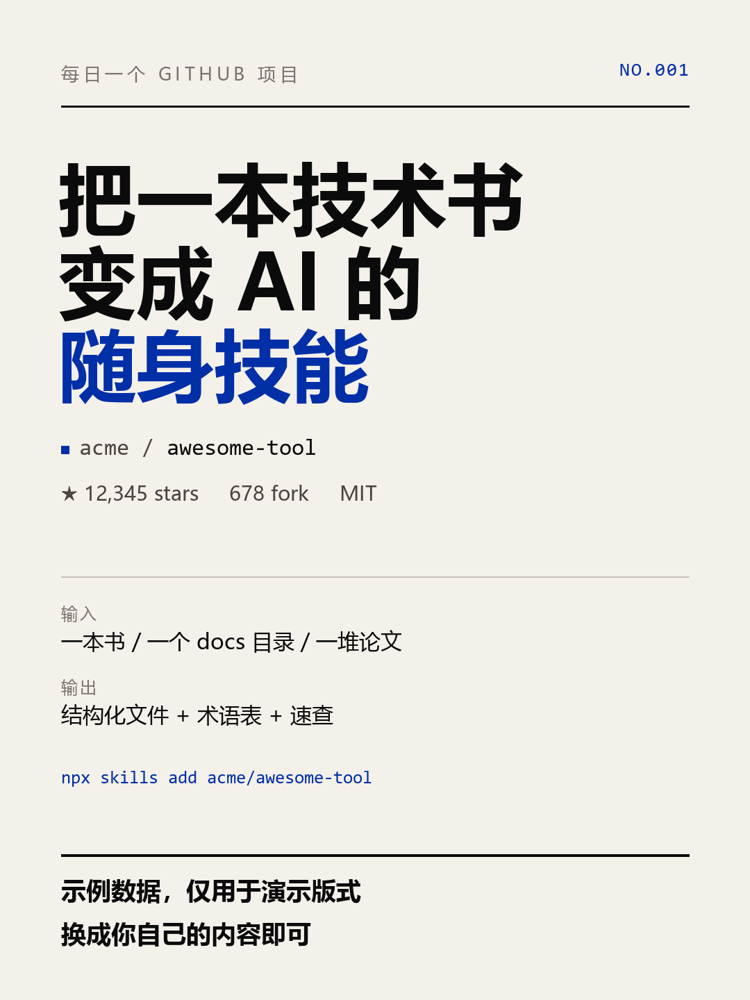
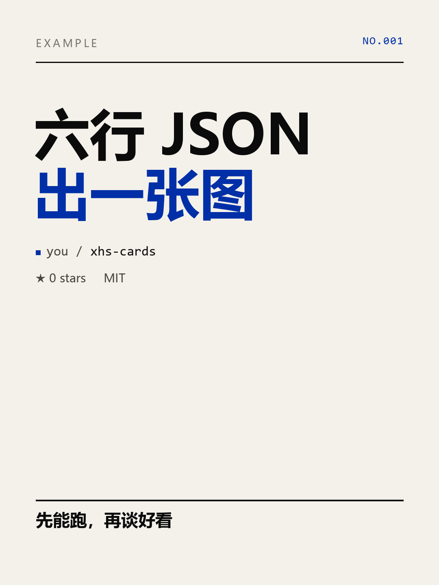

# xhs-cards

[](https://github.com/smhchylxr-cloud/xhs-cards/actions/workflows/ci.yml)
[](LICENSE)


Turn a JSON file into a 1080×1440 card deck. One dependency (`Pillow`), no browser, no API key.

Built for people who publish the same shape of post every day: write the copy once, render the deck with one command, upload the files.



## 60 seconds

```bash
pip install xhs-cards

curl -O https://raw.githubusercontent.com/smhchylxr-cloud/xhs-cards/main/examples/minimal.json
xhs-cards build minimal.json -o out/
```

You get `out/01_cover.png`, 1080×1440, and that is the whole loop.



<details>
<summary>The JSON behind that image (6 keys)</summary>

```json
{
  "theme": "ikb",
  "compact": true,
  "pages": [
    {
      "type": "cover",
      "eyebrow": "EXAMPLE",
      "no": "NO.001",
      "headline": ["六行 JSON", "出一张图"],
      "repo": "you/xhs-cards",
      "stats": ["★ 0 stars", "MIT"],
      "cmd": "xhs-cards build minimal.json",
      "hook": ["先能跑，再谈好看"]
    }
  ]
}
```
</details>

## Install

| How | Command |
|---|---|
| pip | `pip install xhs-cards` |
| uv | `uv tool install xhs-cards` |
| from source | `git clone … && pip install -e .` |
| Docker | `docker build -t xhs-cards .` then `docker run --rm -v "$PWD:/work" xhs-cards build issue.json -o out` |

**You need a CJK font.** Without one, Chinese text renders as boxes or the loader stops with a list of paths it tried. Usually it is already there:

| OS | Font it finds | If missing |
|---|---|---|
| Windows | 微软雅黑 (`msyh.ttc`) | preinstalled |
| macOS | 苹方 (`PingFang.ttc`) | preinstalled |
| Debian/Ubuntu | Noto Sans CJK | `apt install fonts-noto-cjk` |
| Anything else | — | `export XHS_FONT_DIR=/path/to/fonts` |

## What it makes

Four page types, all on a 1080×1440 canvas:

| Type | Use it for | Keys |
|---|---|---|
| `cover` | one claim, big type | `headline`, `repo`, `stats`, `cmd`, `hook` (optional `in` / `out`) |
| `list` | 2–3 numbered arguments | `h2`, `items[{n,title,desc}]` |
| `steps` | how to use the thing | `h2`, `steps[{n,title,desc}]` — a line starting with `$` renders as a terminal command |
| `note` | caveats, boundaries | `h2`, `blocks[{label,lines}]` |

Every page takes `eyebrow` (top-left label) and `no` (top-right marker); `list` / `steps` / `note` also take `foot: [label, text]`.

Two rendering modes worth knowing:

- `"compact": true` — cover keeps only headline, repo and stats. Cards you read at thumbnail size need less, not more.
- `"texture": true` plus per-page `marks` — paper grain, felt-tip notes, circles, underlines. Details in [README › hand-made touches](#hand-made-touches).

## CLI

```bash
xhs-cards build issue.json -o out/     # → out/01_cover.png, out/02_list.png, …
xhs-cards build issue.json --jpeg      # straight to white-background JPEG
xhs-cards export out/                  # → out/upload/01_cover.jpg … (renamed, stripped)
```

`export` is what you run before uploading: it flattens transparency onto white, drops EXIF, and numbers the files so upload order is unambiguous.

## Python

```python
from xhs_cards import build, load_spec

build(load_spec("issue.json"), "out/", jpeg=True)
```

It returns the list of written paths — nothing else happens, no network, no state.

## Hand-made touches

Clean vector output reads as generated. `"texture": true` adds faint paper grain; `marks` draws pen annotations:

```json
{ "type": "cover", "marks": [
  { "kind": "note",      "xy": [96, 968], "text": "这套图就是它出的", "size": 48, "angle": -2.2 },
  { "kind": "underline", "x0": 96, "x1": 560, "y": 1032 },
  { "kind": "circle",    "center": [110, 494], "rx": 46, "ry": 36 },
  { "kind": "highlight", "box": [88, 700, 460, 760], "alpha": 70 }
] }
```

numpy is optional: with it you get smoother noise, without it a Pillow-only path does the same job.

## Troubleshooting

| Symptom | Cause | Fix |
|---|---|---|
| `RuntimeError: No CJK font found` | no CJK font on PATH | `apt install fonts-noto-cjk`, or set `XHS_FONT_DIR` |
| Chinese turns into boxes | a Latin-only font matched first | point `XHS_FONT_REGULAR` / `XHS_FONT_BOLD` at a real CJK face |
| `LayoutError: page 2 overflows` | too much text for 1180 px | shorten the text, or split into another page |
| Text looks soft after upload | PNG re-encoded by the platform | use `--jpeg` so it is already compressed once |
| Emoji missing | the font has no emoji glyphs | keep emoji out of the cards |

## Design choices

Deliberately absent: AI calls, publishing, a GUI. It renders text you wrote; posting stays a human action. That is why it is ~800 lines instead of a product.

Text is measured with the real font, never estimated: lines wrap by measured width, headlines shrink until they fit, and a page that still overflows fails loudly instead of drawing outside the canvas.

## Development

```bash
pip install -e ".[dev]"
pytest -q
xhs-cards build examples/project.json -o out/project
```

`examples/` holds three decks: `project.json` (project recommendation), `review.json` (tool review), `tutorial.json` (walkthrough).

## License

MIT
